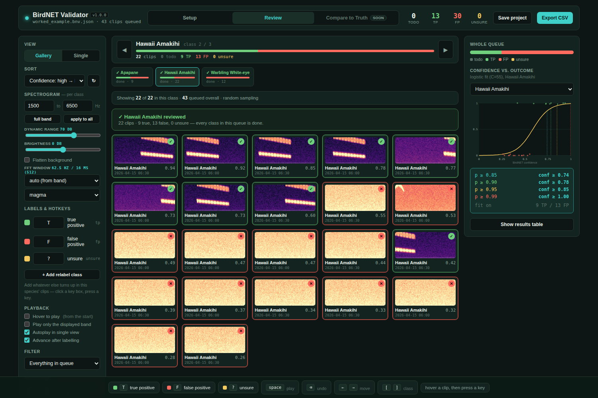

# BirdNET Validator

Review BirdNET detections, label them true or false positive, and fit the
confidence threshold that buys you a target precision — in one browser page, with
your audio staying on your own disk.



**[Launch it](https://blegottesman.github.io/bioacoustics-dashboards/birdnet-validator/)**
· or download `index.html` and open it locally.

---

## Why this exists

BirdNET-Analyzer's own review path cuts clips into `Positive/` and `Negative/`
subfolders and moves files around on disk as you label. That works, but it means
your labels live in a folder structure, re-running with different parameters
starts over, and the clips have to be extracted before you can look at any of them.

This tool keeps the labels in a project file and reads the audio on demand:

- **Clips are cut on the fly.** It seeks into your original hour-long WAV or FLAC
  by byte range and decodes only the three seconds it needs — a few milliseconds
  per clip, a few hundred kilobytes of memory, instead of decoding a 345 MB file.
- **One class at a time.** The review tab is scoped to a single species, with
  panels to page between them, because deciding "is this an ʻApapane" is a
  different task from "is this an ʻIʻiwi" and mixing them makes you worse at both.
- **Labels are data, not folders.** Everything lands in a `.bnv.json` project file
  and a CSV export. Nothing on disk is moved or renamed.
- **The spectrogram is adjustable per class.** Frequency band, FFT window,
  dynamic range, colormap. A tinamou at 700 Hz and an ʻAmakihi at 4 kHz do not
  want the same settings, and a default that suits one hides the other.

It uses BirdNET's own segment-selection parameters (minimum/maximum confidence,
random / confidence / balanced sampling, segments per file, segment length) and
BirdNET's own threshold maths — `LogisticRegression(C=55)` on
confidence → outcome, solved for p = 0.85, 0.90, 0.95 and 0.99.

---

## Quickstart

1. **Open the page.** Chrome or Edge if you can (see browser support in the
   [top-level README](../README.md)).
2. **Setup → Detections.** Drop in your BirdNET results CSV. Combined table or
   per-file tables both work; the column mapping is guessed and shown to you to
   correct.
3. **Setup → Audio.** Click *Grant access to audio folder* and pick the folder
   holding your recordings. One prompt per folder; add as many folders as your
   detections span. Files are opened on demand, not loaded.
4. **Setup → Segment parameters.** Same knobs as BirdNET's Segments tab. Press
   **Process**.
5. **Review.** Hover a clip and press `T` (true) or `F` (false), or `?` for unsure.
   Click a spectrogram to play from that point. `[` and `]` move between classes.
   Add your own relabel classes and hotkeys in the left rail when a species' clips
   keep turning out to be something else.
6. **Read the threshold.** The panel on the right fits the logistic curve as you
   label and shows the confidence cut-off for each target precision.
7. **Save project** writes a `.bnv.json` you can reopen later — queue, every
   label, your hotkeys, your spectrogram settings. **Export CSV** writes the
   labelled table.

### Hotkeys

| Key | Does |
|---|---|
| `T` / `F` / `?` | true positive / false positive / unsure, on the clip under the cursor |
| `space` | play the current clip |
| `←` `→` | move between clips |
| `[` `]` | previous / next class |
| `⌫` | undo the last label (including a bulk one) |

---

## Try it on the worked example

`examples/` holds a complete, self-checking example. It is synthetic — two
two-minute recordings with planted song events — so it is small enough to live in
a repo and its ground truth is known exactly.

```
examples/
  audio/KAUAI01_20260415_060000.flac    two 2-minute recordings, 32 kHz mono
  audio/KAUAI01_20260415_063000.flac
  BirdNET_CombinedTable.csv             43 detections across 3 classes
  expected_labels.csv                   the ground truth for those 43
  expected_export.csv                   what your CSV export should look like
  worked_example.bnv.json               the finished project, fully labelled
```

**To check your install works:** load `BirdNET_CombinedTable.csv`, grant access to
`examples/audio/`, set minimum confidence to 0.25 and segments per file to 200,
and press Process. You should get **43 clips in 3 classes**. Reopen
`worked_example.bnv.json` to see it already labelled.

**What you should see once it's labelled** (13 true, 30 false overall):

| Class | n | p ≥ 0.85 | p ≥ 0.90 | p ≥ 0.95 | p ≥ 0.99 |
|---|---|---|---|---|---|
| Hawaii Amakihi | 22 (9 TP / 13 FP) | conf ≥ 0.74 | conf ≥ 0.78 | conf ≥ 0.85 | conf ≥ 1.00 |
| Apapane | 9 (4 TP / 5 FP) | conf ≥ 0.94 | not reachable | not reachable | not reachable |
| Warbling White-eye | 12 (0 TP / 12 FP) | no fit — needs both classes | | | |

These match `sklearn.linear_model.LogisticRegression(C=55)` on the same labels to
within 0.01, which is the check that the in-browser solver agrees with BirdNET's.

The example is also a lesson in reading your own output honestly: with **n = 9**,
the ʻApapane fit is not a defensible threshold, and the tool says so by declining
to extrapolate rather than printing a confident number. In real use, aim for on
the order of 100 labelled clips per class spread across the confidence range.

---

## Where your labels live

Nothing is written to your audio folder and nothing is uploaded.

- **`.bnv.json` project file** — the whole review state: queue, labels, relabels,
  hotkeys, segment parameters, per-class spectrogram settings, and the build of
  the tool that wrote it (`appVersion`). Reopening puts you back where you stopped.
- **CSV export** — one row per reviewed clip:
  `file, start_s, end_s, predicted_class, confidence, label, relabel_class, timestamp_utc, validator_version`
- **Browser storage** is only a crash net. It autosaves so a closed tab doesn't
  cost you an afternoon, but it is per-browser and not a backup. Save the project
  file.

A note on the folder handle: the project file records the *name* of your audio
folder but cannot record permission to read it — browsers don't allow that. On
reopening, grant access to the folder again; there is a **Reconnect last folder**
button that makes this one click.

---

## Known limits

- Folder access needs a Chromium browser (see above).
- Formats: WAV and FLAC seek by byte range and are fast on hour-long files. MP3
  and OGG fall back to decoding the whole file, which is slow for long recordings.
- The **Compare to Truth** tab is not built yet.
- Site-stratified sampling ("top X per time window per site") is specified but not
  implemented — the site is not reliably recoverable from a filename without being
  told which token it is.
- Confidence intervals on the logistic curve are not drawn yet; only the fitted
  curve and the threshold lines.

## Version

Current build is shown next to the title in the page header and stamped into every
project file and CSV export. See [CHANGELOG.md](CHANGELOG.md).
